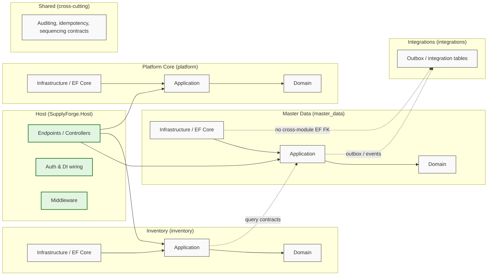

# SupplyForge

Modular-monolith backend for the full goods lifecycle: supplier → purchase → receipt → stock → sale → shipment → invoice → payment → report. One company, three seeded branches. Portfolio backend, not a certified ERP.

## Table of Contents

- [Overview](#overview)
- [Architecture](#architecture)
- [Technology Stack](#technology-stack)
- [Implemented Functionality (through A1-10)](#implemented-functionality-through-a1-10)
- [Project Structure](#project-structure)
- [Getting Started](#getting-started)
- [Verification Results (A1-10, 2026-11-27)](#verification-results-a1-10-2026-11-27)
- [Migration Status](#migration-status)
- [CI/CD Status](#cicd-status)
- [Testing Strategy](#testing-strategy)
- [Security Considerations](#security-considerations)
- [Contribution Guidelines](#contribution-guidelines)
- [License](#license)
- [Disclaimer](#disclaimer)

## Overview

SupplyForge is a modular-monolith ASP.NET Core Web API backend covering the end-to-end goods lifecycle within a single company and three seeded branches. Each module owns its schema and tables; cross-module reads use public query contracts and writes use public commands or outbox events in the same transaction. The system is implemented as a portfolio demonstration of modular-monolith design patterns, including an append-only stock ledger, weighted average cost (WAC), warehouse transfers with partial receiving, adjustments, opening imports, replenishment alerts, availability queries, and branch-isolated access control.

## Architecture

SupplyForge follows Clean Architecture within each module: Domain → Application ← Infrastructure. The Host owns HTTP endpoints, authentication wiring, DI composition, and middleware. Business logic never appears in the Host, and EF entities are never exposed through the API.



### Module ownership

| Module | Schema | Owns |
|--------|--------|------|
| Platform Core | `platform` | users, roles, permissions, branch/warehouse scope, audit, notifications, API keys, auth |
| Integrations | `integrations` | outbox / integration-adjacent tables |
| Master Data | `master_data` | company, branches, product catalogue, partners, tax rates, payment terms, reason codes, warehouses, storage locations |
| Inventory | `inventory` | stock movements, stock balances, product cost (WAC), transfers, adjustments, opening imports |
| Shared kernel | cross-cutting | auditing interfaces, idempotency, sequencing, notifications contracts |

### Enforced architectural rules

- No module reads or writes another module's tables. Cross-module reads go through public query contracts; writes go through public commands or events published to the outbox in the same transaction.
- Only Inventory posts stock movements. Sales must never read Finance tables.
- Reporting is event-only and owns no operational writes.
- EF entities are never exposed through the API; request/response DTOs are used.
- Dependencies point inward only; no circular references.
- Inventory references MasterData.Contracts only — no cross-module implementation dependency.

## Technology Stack

| Layer | Technology | Version |
|-------|-----------|---------|
| Language | C# | .NET 10 |
| Web Framework | ASP.NET Core Web API | — |
| ORM | EF Core | 10 |
| Database | SQL Server | 2022 |
| Testing | xUnit | unit + integration + architecture |
| Container | Docker Compose | SQL Server service |
| API Docs | OpenAPI | generated from code |
| CI | GitHub Actions | build → format → unit tests → architecture tests → inventory integration tests |

## Implemented Functionality (through A1-10)

### Master Data and Organizational Structure

- **Company** — singleton legal entity with profile fields (base currency, timezone, default language)
- **Branches** — three seeded branches with unique codes
- **Product catalogue** — products with code, name, description, status lifecycle (Active/Inactive/Archived), category hierarchy, unit of measure with conversions
- **Partners** — suppliers and customers with statuses, credit limits, addresses (default shipping/billing)
- **Shared lookups** — tax rates, payment terms, reason codes
- **Warehouses** — branch-owned, unique company-wide code
- **Storage Locations** — five location types (Receiving, Quarantine, Storage, Returns, Staging), warehouse-owned; Blocked is a separate per-location flag

### Branch and Warehouse Scope

- `ICurrentBranchScope` resolves per-request branch access (branch IDs + company-wide flag + `CanAccess(Guid)`)
- Fail-closed by default: a request with no accessible branch sees nothing
- System scope (for seed/migration/background jobs) is set only by the Host, never from HTTP
- Branch validation is enforced at the Inventory layer via `IWarehouseBranchResolver` (Inventory references MasterData.Contracts only — no cross-module implementation dependency)

### Inventory: Stock Movements and Posting

- **StockMovement** — immutable append-only ledger (INSERT-only after creation; INV-010/012)
- **Qty sign convention** — Issue/TransferOut/AdjustmentOut = negative; Receipt/TransferIn/AdjustmentIn/OpeningBalance = positive
- **StockBalance** — unique on (ProductId, WarehouseId, LocationId); concurrency protected with HOLDLOCK/UPDLOCK
- **ProductCost** — WAC cost bucket per (ProductId, WarehouseId), scale-8 rounding
- **StockMovementPoster** — atomic posting inside the ambient session: HOLDLOCK on StockBalance + ProductCost, WAC application, idempotency claim/complete, no `FailAsync` (rollback via ambient transaction)
- **Negative stock protection** — poster rejects issues/transfers/adjustments that would drive on-hand below zero (INV-NEG)
- **StockMovement** fields — `BranchId` (denormalized from warehouse at posting), `CreatedByUserId` (nullable, for system scope), `CorrelationId` (traces to HTTP request correlation ID)
- **DB-level immutability** — INSTEAD OF UPDATE/DELETE triggers on `inventory.StockMovement` + DENY UPDATE/DELETE at database level

### Warehouse Transfers and Partial Receiving

- **Transfer document lifecycle** — Draft → Approved → (same-warehouse: Closed atomically) / (inter-warehouse: In Transit → Received → Closed)
- **Same-warehouse location move** — TransferOut + TransferIn posted atomically in one ambient transaction → Closed
- **Inter-warehouse** — Shipping (TransferOut → In Transit) and Receiving (TransferIn → ReceivedQty increment) are separate ambient transactions per leg/receipt
- **Source WAC preservation** — TransferOut mutates `movement.UnitCost` in place; each partial TransferIn reads the original TransferOut's UnitCost — every partial receipt uses the same source WAC
- **Concurrent receive serialization** — `WITH (UPDLOCK, ROWLOCK, HOLDLOCK)` on the Transfer row serializes concurrent receives; ShippedQty/ReceivedQty re-read inside the lock
- **Over-receipt prevention** — ReceiveQty cannot exceed remaining shipped quantity
- **Transfer shortfall reconciliation (INV-032)** — transfer-shortfall Adjustment with `SourceDocumentType="Transfer"`, `SourceDocumentId=TransferId` — audit/documentation only, creates no StockMovements, Status=Posted; duplicate prevention via idempotency claim

### Adjustments (INV-040)

- **Adjustment lifecycle** — Draft → Approved → Posted → Rejected
- **Normal adjustment** — posts AdjustmentIn/AdjustmentOut movements via the poster; negative-stock guard enforced
- **Transfer-shortfall adjustment** — audit-only, Status=Posted, no movements
- **Reject** permitted from Draft, Approved; not from Posted or Rejected
- **INV-041** (threshold approval, creator cannot approve) is blocked on B1 and not implemented

### Opening Imports (INV-014)

- **OpeningImport lifecycle** — Draft → Validated (dry-run, no movements) → Posted → Rejected
- **Dry-run validation** — validates qty > 0, LocationId present, warehouse exists and is branch-accessible; no StockMovements posted
- **Posting** — creates OpeningBalance movements via the poster; idempotency key per line (`opening:{ImportId}:line:{Index}`)
- **LocationId required** because the poster locks StockBalance by (ProductId, WarehouseId, LocationId)

### Weighted Average Cost (WAC)

- Bucket = ProductId + WarehouseId
- Opening blend, receipt blend, issue blend, transfer blend
- Scale-8 rounding, no negative average
- WAC-01…06, WAC-08…11 implemented; WAC-07 (reversal eligibility) blocked on OD-03

### Transaction Handling

- **AmbientDbSession** — one shared `SqlConnection` + `DbTransaction`, enlists every joined DbContext via `SetDbConnection` + `UseTransactionAsync`
- All joined contexts share the same connection string (one SQL Server, per-module schemas)
- Commit once; rollback on failure
- `InventoryDbContext.SaveChangesAsync` rejects Modified/Deleted on `StockMovement` (INSERT-only)

### Idempotency

- `IIdempotencyStore.TryClaimAsync` returns Claimed/AlreadyCompleted/PayloadMismatch/InProgress
- `CompleteAsync` marks completed; failed claims roll back with ambient transaction (no `FailAsync`)
- Idempotency keys include document type, document ID, and line index where applicable

### Concurrency Protection

- `StockBalance` locked with `HOLDLOCK` on (ProductId, WarehouseId, LocationId)
- `ProductCost` locked with `HOLDLOCK/UPDLOCK`
- Transfer row locked with `WITH (UPDLOCK, ROWLOCK, HOLDLOCK)` during receive
- Concurrent balance inserts serialized; retry allows all to succeed

### Replenishment (INV-060, INV-061)

- **ReorderPoint** per ProductId + WarehouseId (WarehouseId nullable = company-wide)
- `ReplenishmentService.CheckReorderPointsAsync` — when Available + Incoming < ReorderPointQty, marks `ReorderPoint.IsAlerted = true` and posts `StockBelowReorderpoint` to the outbox
- `ClearRecoveredAlertsAsync` — resets `IsAlerted = false` when stock recovers above threshold (alert once per breach until recovered)
- Runs inside ambient session with HOLDLOCK on ReorderPoint row to prevent double-alerting under concurrent execution
- System-only operation (no HTTP endpoint)

### Availability Query (INV-100)

- `AvailabilityQueryService` returns all stock buckets per product+warehouse: OnHand, Available (eligible on-hand minus reserved), Reserved, Blocked, InTransit, IncomingQty, IncomingDate
- Branch scope enforced: caller must have access to warehouse's branch

### Returns Location Guard (INV-091)

- `StockMovementPoster` rejects inbound (Qty > 0) movements to LocationType = "Returns" locations
- Outbound movements to Returns locations are allowed

### Branch Isolation (BRN-011…014)

- `BranchGuard` (`IWarehouseBranchResolver` + `ICurrentBranchScope`) enforces branch access on all inventory operations
- Transfer creation, approval, shipping, receiving, closing, cancellation — all validate branch access
- Adjustment creation, approval, posting, rejection — all validate branch access
- Opening import creation, validation, posting, rejection — all validate branch access

## Project Structure

```
SupplyForge/
├── src/
│   ├── Host/SupplyForge.Host/          # HTTP endpoints, auth wiring, DI composition, middleware
│   ├── Modules/
│   │   ├── PlatformCore/               # users, roles, permissions, scope, audit, notifications
│   │   ├── Integrations/               # outbox / integration tables
│   │   ├── MasterData/                 # company, branches, products, partners, warehouses, locations
│   │   └── Inventory/                  # stock movements, balances, WAC, transfers, adjustments, opening imports
│   └── Shared/                         # cross-cutting contracts (auditing, idempotency, sequencing)
├── tests/
│   ├── ArchitectureTests/              # dependency direction, module boundary rules
│   ├── PlatformCore.UnitTests/
│   ├── PlatformCore.IntegrationTests/
│   ├── MasterData.UnitTests/
│   ├── MasterData.IntegrationTests/
│   ├── Inventory.UnitTests/
│   └── Inventory.IntegrationTests/     # throwaway SQL Server databases per test run
├── docs/
│   ├── prd/                            # product requirements (INDEX.md → navigation)
│   ├── A0-PROGRESS.md                  # increment log (slice A0)
│   ├── A1-PROGRESS.md                  # increment log (slice A1)
│   ├── HANDOFF.md                      # session continuity
│   ├── Decision Register.md            # accepted owner decisions
│   └── DATABASE-GUIDE.md               # verified database structure
├── ADR/                                # accepted architecture decisions (001–006, 008, 009)
├── .kilo/plans/                        # execution plans (not authoritative)
├── scripts/                            # quota and checkpoint tooling
├── README.md                           # this file
├── AGENTS.md                           # AI-assisted development agreements
├── HANDOFF.md                          # root handoff (byte-identical to docs/HANDOFF.md)
└── docker-compose.yml                  # SQL Server service
```

## Getting Started

### Prerequisites

- .NET 10 SDK
- Docker with Compose (for SQL Server)

### 1. Clone the Repository

```bash
git clone https://github.com/AhmadZaqiq/SupplyForge.git
cd SupplyForge
```

### 2. Configuration

```bash
cp .env.example .env   # first time; adjust MSSQL_SA_PASSWORD if needed
```

The `.env` file is gitignored and contains only local development secrets. Never commit it.

### 3. Start SQL Server

```bash
docker compose up -d sqlserver
```

### 4. Run the Host

```bash
dotnet run --project src/Host/SupplyForge.Host
```

The host seeds the permission catalogue and system role bundles at startup (idempotent; no migration involved). The Master Data seed skips with a warning when `master_data` schema is absent, so a pre-A1 database still boots.

### 5. Migrations (owner approval required)

Migrations change module-owned schema and require owner approval before running. All migration files exist but none have been applied to the dev database. When approved:

```bash
dotnet ef database update --project <module> --startup-project src/Host/SupplyForge.Host
```

### 6. Tests and Format

```bash
dotnet build                          # 0 errors, 0 warnings
dotnet test                           # unit + integration + architecture tests
dotnet format --verify-no-changes     # formatting check
```

Integration tests for Inventory create and drop throwaway SQL Server databases per test run. PlatformCore integration tests connect to the shared dev database (requires the `IsCompanyWide` migration to be applied).

## Verification Results (A1-10, 2026-11-27)

| Check | Result |
|-------|--------|
| `dotnet build` | 0 errors, 0 warnings |
| Inventory UnitTests | 45/45 passed |
| PlatformCore UnitTests | 75/75 passed |
| ArchitectureTests | 21/21 passed |
| Inventory IntegrationTests | 111/109 passed (all pass) |
| PlatformCore IntegrationTests | 62/104 passed (42 pre-existing failures due to `IsCompanyWide` migration not applied to shared dev DB — not code defects) |
| `dotnet format --verify-no-changes` | Clean |
| Migrations applied to dev DB | None (file only) |

## Migration Status

All migrations are file-only — not applied to the development database. Owner approval required before applying.

| Migration | Module | Description |
|-----------|--------|-------------|
| `20261124181017_A1WarehousesLocations` | Master Data | Warehouse + StorageLocation |
| `20261125171326_A1InventoryLedger` | Inventory | StockMovement + StockBalance + ProductCost |
| `20261126004151_A1TransferOrchestration` | Inventory | Transfer + Adjustment + OpeningImport |
| `20261126213917_A1_UnitCostPrecision` | Inventory | UnitCost precision 18→8 |
| `20261126235623_A1_ReplenishmentAvailability` | Inventory | ReorderPoint + OpeningImport tables |
| `20261127005049_A1_UserIsCompanyWide` | Platform Core | `IsCompanyWide` column on `platform.User` |
| `20261127171551_A1_StockMovementAuditing` | Inventory | StockMovement.BranchId, CreatedByUserId, CorrelationId + INSTEAD OF triggers + DENY |
| `20261127182116_A1_IdempotencyKeyUpdatedAt` | Platform Core | IdempotencyKey.UpdatedAt column |
| `20261127192836_A1_ReplenishmentIndexes` | Inventory | filtered unique indexes on ReorderPoint and IncomingProjection |

## CI/CD Status

- `.github/workflows/ci.yml` exists but has NOT been executed via GitHub Actions yet (no GitHub Actions run history)
- CI workflow: build → format → unit tests → architecture tests → inventory integration tests against disposable SQL Server container

## Testing Strategy

| Test Type | Project | Database | Requirement IDs in names |
|-----------|---------|----------|-------------------------|
| Unit | `tests/Inventory.UnitTests/` | None (pure domain logic) | Yes (NFR-051) |
| Integration | `tests/Inventory.IntegrationTests/` | Throwaway SQL Server per run | Yes (NFR-051) |
| Architecture | `tests/ArchitectureTests/` | None | Dependency direction rules |

Requirement IDs are included in test names (NFR-051). Unit tests cover pure domain logic with no database. Integration tests use throwaway SQL Server databases per run for Inventory, or the shared dev database for PlatformCore. Architecture tests enforce dependency direction and module boundary rules.

## Security Considerations

- JWT Bearer authentication (access tokens, 15-min TTL, HS256)
- API keys via `X-Api-Key` header for integration clients
- Authorization is deny by default: every request re-authorizes
- Endpoints declare named `perm:*` policies
- Unauthenticated/under-permitted callers get 401/403
- SEC-20: Production startup fails fast on placeholder secrets
- Rate limiting on auth endpoints (per IP and per account)
- No secrets, tokens, or passwords are hardcoded or logged
- `.env` is gitignored; real secrets arrive via environment variables

## Contribution Guidelines

1. Read `docs/HANDOFF.md` and `AGENTS.md` before starting work
2. Follow the reading protocol: PRD INDEX → Core set → slice files → one requirement at a time
3. Put requirement IDs in test names (NFR-051) and commit/PR titles
4. Run `dotnet build`, `dotnet test`, and `dotnet format --verify-no-changes` after changes
5. Never commit, push, or deploy without explicit owner approval
6. Do not invent APIs, files, requirements, or results — ask when uncertain
7. Preserve existing uncommitted work; check `git status` before editing

## License

No license file exists in this repository. This is a portfolio project, not a certified ERP system.

## Disclaimer

SupplyForge is a portfolio backend demonstrating modular-monolith design patterns. It is not a certified ERP system and is not intended for production use without thorough security review, testing, and compliance validation.
