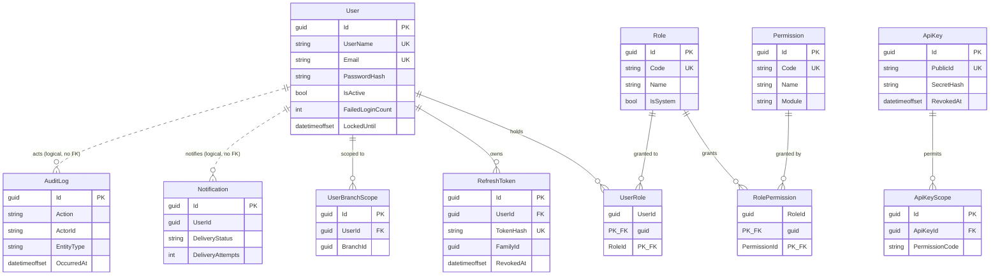
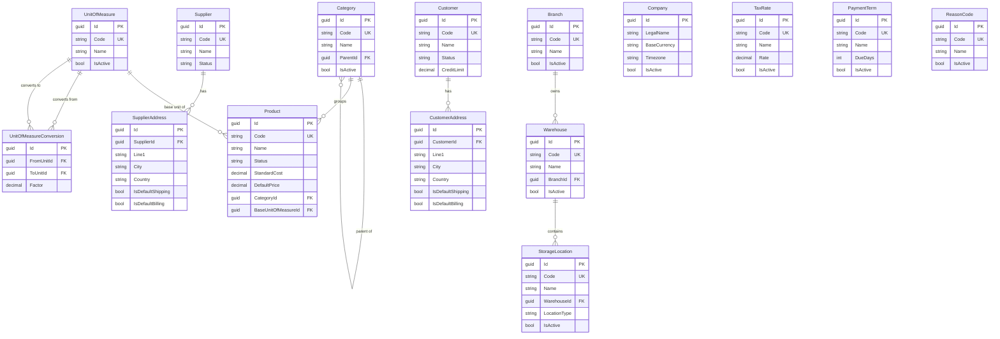
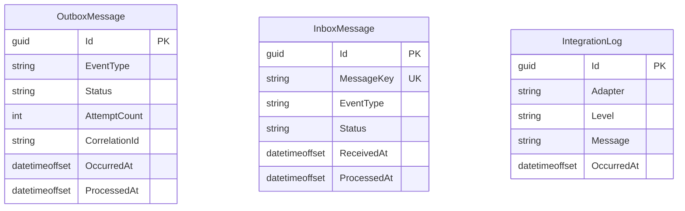

# Database Guide — SupplyForge

**Purpose:** explain every table that exists today, how the tables relate to each
other, and what actually happens to the data when a user logs in.

**Source of truth:** the EF Core model snapshots and migrations on disk
(`src/Modules/*/SupplyForge.*.Infrastructure/Data/Migrations/*ModelSnapshot.cs`),
cross-checked against the entity classes. This guide is **descriptive of the
current schema, not a requirements source** — it goes stale the moment a
migration changes the model, so re-read the snapshot when that happens.

**Scope:** 3 modules, 3 schemas, **32 tables**, all in one SQL Server database
(`SupplyForge`). Nothing outside these three modules owns tables yet.

---

## 1. Glossary

Every term below is defined here once and reused afterwards.

| Term | Meaning |
|---|---|
| **Table** | A named, rectangular grid of rows inside a database schema. This project's tables are created by EF Core migrations. |
| **Schema** | A namespace *inside* one database — a prefix that groups tables, written `schema.Table` (e.g. `platform.User`). Three schemas exist: `platform`, `master_data`, `integrations`. |
| **Column** | One named field of a table (e.g. `UserName`). Each column has one data type. |
| **Row (record)** | One horizontal entry in a table — one user, one product, one message. |
| **Primary key (PK)** | The column(s) that uniquely identify a row. Written **PK** below. A table cannot have two rows with the same PK. |
| **Foreign key (FK)** | A column holding the PK of another row, used to point at it. Written **FK** below. The database can reject the write if the pointed-at row does not exist. |
| **Relationship** | The link an FK creates. **One-to-many (1:N)**: one parent row (e.g. a `User`) has many child rows (e.g. many `UserRole` rows) — each child points back with exactly one parent id. |
| **Junction table** | A table that exists only to express a many-to-many relationship: it has two FKs and almost no data of its own (`UserRole`, `RolePermission`). |
| **Unique index** | A rule forcing a column (or set of columns) to never repeat — e.g. `User.UserName`. Different from the PK but same idea. |
| **Index** | An auxiliary structure that makes lookups on a column fast. Does not change what data is stored. |
| **Concurrency token** | A column the database bumps automatically on every update (`rowversion`, shown as `RowVersion`); the app refuses to overwrite a row whose token changed under it. Prevents lost updates. |
| **Delete behaviour** | What happens to child rows when the parent is deleted. **Cascade** = children are deleted too. **Restrict** = the delete is refused (the project uses this deliberately: rows are deactivated, not deleted). |
| **Migration** | An EF Core-generated script that moves the physical schema from one version to the next. Applied explicitly, never automatically. |
| **DTO** | Data transfer object — a plain shape sent over HTTP; never a database row. |
| **In-memory** | Kept in process RAM only, lost on restart — used for rate limiting on purpose (MOD-8: no Redis). |

---

## 2. The three modules at a glance

| Module | Schema | Tables | Owns |
|---|---|---|---|
| **PlatformCore** | `platform` | 14 | Identity (users/roles/permissions), tokens, API keys, audit trail, notifications, sequences, idempotency, job runs |
| **MasterData** | `master_data` | 15 | Company, branches, product catalogue, partners (supplier/customer + addresses), tax rates, payment terms, reason codes, **warehouses, storage locations** |
| **Integrations** | `integrations` | 3 | Outbox, inbox, integration log |

**Cross-module rule (MOD-1):** each module reads and writes only its own tables.
Consequently **no FK crosses a schema boundary**. Where one module needs a value
another module owns, it stores the id as a plain `Guid` with no FK constraint —
the link is *logical*, not enforced by the database. `platform.UserBranchScope.BranchId`
is the clearest example: it points at `master_data.Branch`, but nothing stops
you writing a branch id that does not exist.

---

## 3. PlatformCore — schema `platform` (14 tables)

### 3.1 Identity and access

**`User`** — one row per person who can log in; the anchor of the whole identity model.
PK `Id` (Guid). Key columns: `UserName` (unique), `Email` (unique), `PasswordHash`
(stored PBKDF2 string), `DisplayName`, `IsActive`, `FailedLoginCount`,
`LockedUntil` (null = not locked), `CreatedAt`, `UpdatedAt`, `RowVersion`
(concurrency token).
Relationships: parent of many `UserRole`, many `RefreshToken`, many `UserBranchScope`
(all FK → `User.Id`). Referenced logically (no FK) by `Notification.UserId` and
`AuditLog.ActorId`.

**`Role`** — a named bundle of permissions; eleven system roles are seeded at startup
(`company_administrator`, `procurement_officer`, …).
PK `Id`. Key columns: `Code` (unique, e.g. `branch_manager`), `Name`, `IsSystem`,
`Description`, `CreatedAt`.
Relationships: parent of many `RolePermission` (FK → `Role.Id`); child of many
`UserRole` (FK → `Role.Id`).

**`Permission`** — one row per capability the system can grant
(`platform.user.manage`, `platform.notification.read`, …).
PK `Id`. Key columns: `Code` (unique), `Name`, `Module` (owning module name).
Relationships: child of many `RolePermission` (FK → `Permission.Id`).

**`UserRole`** — **junction table**: which user holds which role. Two roles for one
user = two rows.
PK is the pair (`UserId`, `RoleId`). FK `UserId` → `User.Id` (Cascade),
FK `RoleId` → `Role.Id` (Cascade).

**`RolePermission`** — **junction table**: which role grants which permission.
PK is the pair (`RoleId`, `PermissionId`). FK `RoleId` → `Role.Id` (Cascade),
FK `PermissionId` → `Permission.Id` (Cascade).

**`UserBranchScope`** — which branches a user may see (branch isolation, BRN-001…014).
PK `Id`. Key columns: `UserId` (FK → `User.Id`, Cascade), `BranchId` (Guid, **no FK** —
`master_data.Branch` lives in another schema), `CreatedAt`. Unique index on
(`UserId`, `BranchId`) so a user cannot be scoped to the same branch twice.

### 3.2 Tokens and machine access

**`RefreshToken`** — one row per issued refresh token; stores only the token's hash,
never the token itself (SEC-03).
PK `Id`. Key columns: `UserId` (FK → `User.Id`, Cascade), `TokenHash` (unique),
`FamilyId` (groups a rotation chain for reuse detection), `ExpiresAt`, `CreatedAt`,
`RevokedAt`, `ReplacedByTokenHash`. Indexes on `FamilyId`, `TokenHash`, `UserId`.
Note: there is **no concurrency token** on this table — see the HANDOFF known-gaps
backlog.

**`ApiKey`** — one row per machine credential issued to an integration client; the
secret is stored hashed.
PK `Id`. Key columns: `PublicId` (unique — the id used for lookup), `SecretHash`,
`Name`, `Description`, `CreatedByUserId` (Guid, no FK), `CreatedAt`, `ExpiresAt`,
`LastUsedAt`, `RevokedAt`.
Relationships: parent of many `ApiKeyScope` (FK → `ApiKey.Id`, Cascade).

**`ApiKeyScope`** — which permission codes a given API key carries.
PK `Id`. Key columns: `ApiKeyId` (FK → `ApiKey.Id`, Cascade), `PermissionCode`
(a string copied from `Permission.Code` — **not** an FK). Unique on
(`ApiKeyId`, `PermissionCode`).

### 3.3 Audit, notifications, bookkeeping

**`AuditLog`** — append-only trail of security-relevant events
(`user.created`, `user.login`, `user.locked`, `refresh.reuse_detected`, …).
PK `Id`. Key columns: `Action`, `ActorId` (string, no FK), `ActorType`,
`EntityType` + `EntityId` (what it happened to), `BranchId` (string, no FK),
`CorrelationId`, `DetailsJson`, `OccurredAt`. Indexes on `EntityType`, `OccurredAt`.

**`Notification`** — one row per in-app notification raised for a user, plus its
delivery state (Pending → Sent, or Failed with retries).
PK `Id`. Key columns: `Title`, `Body`, `NotificationType`, `UserId` (Guid, no FK),
`BranchId` (Guid, no FK), `Link`, `CreatedAt`, `ReadAt`, `DeliveryStatus`
(`Pending`/`Sent`/`Failed`), `DeliveryAttempts`, `LastDeliveryError`,
`NextAttemptAt`, `SentAt`. Indexes on `NotificationType`,
(`DeliveryStatus`, `NextAttemptAt`), (`UserId`, `ReadAt`).

**`DocumentSequence`** — a single-row-per-scope counter that hands out document
numbers so they are gapless and unique.
PK `Scope` (a string, not a Guid — the scope *is* the key, e.g. `po`). Key columns:
`LastValue`, `UpdatedAt`.

**`IdempotencyKey`** — makes a repeated safe-to-retry POST return the original
response instead of acting twice (IDEMP-01).
PK `Key` (string). Key columns: `Status`, `PayloadHash`, `ResponseSnapshotJson`,
`CreatedAt`, `CompletedAt`. Index on `CreatedAt`.

**`JobRun`** — one row per background job execution, for observability.
PK `Id`. Key columns: `JobName`, `Status`, `StartedAt`, `CompletedAt`, `Error`,
`CorrelationId`. Index on `JobName`.

### 3.4 PlatformCore ER diagram

`||..o{` means *logical reference with no foreign-key constraint* — the database
will not stop you writing a dangling id.

---

## 4. MasterData — schema `master_data` (15 tables)

**Note:** The A1-4 migration `20261124181017_A1WarehousesLocations` (creating `Warehouse` and `StorageLocation`) exists as a file but has **not been applied** to any database. The tables described below include these two new tables.

**`Company`** — the legal entity the whole system runs for. Deliberately a
**singleton**: a partial unique index on `IsActive` (filtered `WHERE IsActive = 1`)
allows at most one active company row.
PK `Id`. Key columns: `LegalName`, `Address`, `TaxId`, `BaseCurrency` (3 letters,
e.g. `USD`), `Timezone`, `DefaultLanguage`, `FiscalYearStartMonth`, `Logo`
(binary), `LogoContentType`, `IsActive`, `CreatedAt`, `UpdatedAt`, `RowVersion`.
Relationships: none — nothing in this schema points at it.

**`Branch`** — one row per physical location the company operates from; three are
seeded (`BR-01`…`BR-03`). Branch isolation tests and `platform.UserBranchScope`
both refer to these ids.
PK `Id`. Key columns: `Code` (unique, ≤20 chars), `Name`, `IsActive`, `CreatedAt`,
`UpdatedAt`, `RowVersion`.
Relationships: none **in this schema** — `platform.UserBranchScope.BranchId`
points here logically, with no FK.

**`Category`** — a product category; categories can nest (parent → children).
PK `Id`. Key columns: `Code` (unique), `Name`, `ParentId` (FK → `Category.Id`,
**Restrict** — self-reference), `IsActive`, `CreatedAt`, `UpdatedAt`, `RowVersion`.
Relationships: parent of many `Category` (its children) and many `Product`.

**`Product`** — one row per sellable/storable item in the catalogue.
PK `Id`. Key columns: `Code` (unique), `Name`, `Description`, `Status`
(`Active`/`Inactive`/`Archived`), `StandardCost` (decimal 18,2), `DefaultPrice`
(decimal 18,2), `ReorderPoint` (decimal 18,4), `LeadTimeDays`,
`RequiresInspection`, `CategoryId` (FK → `Category.Id`, **Restrict**, nullable),
`BaseUnitOfMeasureId` (FK → `UnitOfMeasure.Id`, **Restrict**, required),
`CreatedAt`, `UpdatedAt`, `RowVersion`.
Relationships: child of `Category` and of `UnitOfMeasure`.

**`UnitOfMeasure`** — a unit products are counted in (`PCS`, `BOX`, `KG`).
PK `Id`. Key columns: `Code` (unique), `Name`, `IsActive`, `CreatedAt`,
`UpdatedAt`, `RowVersion`.
Relationships: parent of many `Product` (as the base unit) and of many
`UnitOfMeasureConversion` (appears twice: as `FromUnitId` and as `ToUnitId`).

**`UnitOfMeasureConversion`** — how many `ToUnit` units make one `FromUnit`
(e.g. 1 BOX = 12 PCS).
PK `Id`. Key columns: `FromUnitId` (FK → `UnitOfMeasure.Id`, **Restrict**),
`ToUnitId` (FK → `UnitOfMeasure.Id`, **Restrict**), `Factor` (decimal 18,4,
check constraint `Factor > 0`), `CreatedAt`. Unique on (`FromUnitId`, `ToUnitId`).

All seven FKs in this module are **Restrict** (zero cascades) — the project's rule
is *deactivate, never delete* (PRD §6.1).

### 4.1 Partners (A1-3)

**`Supplier`** — one row per supplier (`Code` unique, ≤30 chars; `Name` ≤200).
PK `Id`. Other columns: `Status` (`Active`/`Inactive`/`Blocked` — stored as a
string status code per DM-5, no approval behaviour in this table),
`CreatedAt`, `UpdatedAt`, `RowVersion`.
Relationships: parent of many `SupplierAddress`.

**`Customer`** — one row per customer (`Code` unique, ≤30; `Name` ≤200).
PK `Id`. Other columns: `Status` (`Active`/`Inactive`/`Blocked`/`OnHold`),
`CreditLimit` (decimal 18,2, NOT NULL, **database default 0** = no credit —
there is no "unlimited" value, TD-3 fails closed; check constraint
`CK_Customer_CreditLimit_NonNegative` rejects negatives), timestamps,
`RowVersion`. Relationship: parent of many `CustomerAddress`.

**`SupplierAddress`** / **`CustomerAddress`** — postal addresses, one row each
per partner (DM-9.2). PK `Id`. Columns: `SupplierId`/`CustomerId` (FK → partner,
**Restrict**), `Line1`, `Line2` (nullable), `City`, `Region` (nullable),
`PostalCode` (nullable), `Country`, `IsDefaultShipping`, `IsDefaultBilling`,
timestamps, `RowVersion`. `Line1`, `City`, `Country` are required.
**Filtered unique indexes** allow at most one default-shipping and one
default-billing row per partner: `... (SupplierId, IsDefaultShipping)
WHERE IsDefaultShipping = 1` and the billing/customer equivalents. Because
each composite index starts with the FK column, EF creates no separate
single-column index on `SupplierId` — the FK prefix is already covered.

### 4.2 Shared master lookups (A1-3)

**`TaxRate`** — a tax percentage the finance module will read (MD-031).
PK `Id`. Columns: `Code` (unique), `Name`, `Rate` (decimal 9,6, stored as a
percentage — FIN-CALC-10; check `CK_TaxRate_Rate_Between0And100` enforces
0 ≤ Rate ≤ 100), `IsActive`, timestamps, `RowVersion`.

**`PaymentTerm`** — when an invoice is due (MD-050, FIN-021).
PK `Id`. Columns: `Code` (unique), `Name`, `DueDays` (int, required; check
`CK_PaymentTerm_DueDays_NonNegative`), `IsActive`, timestamps, `RowVersion`.

**`ReasonCode`** — one **global** list of reason codes used by stock
adjustments and other documents (MD-050). PK `Id`. Columns: `Code` (unique),
`Name`, `IsActive`, timestamps, `RowVersion`. Deliberately **no purpose
column** — the owner approved one global list (A1-3 decision D9); a purpose
column can be added later without breaking existing rows.

### 4.3 Warehouses and Storage Locations (A1-4 Part 1, uncommitted)

**`Warehouse`** — one row per physical warehouse; branch-owned (MD-040).
PK `Id`. Key columns: `Code` (unique, ≤30 chars, **company-wide non-filtered** — Q-A),
`Name`, `BranchId` (FK → `Branch.Id`, **Restrict**), `IsActive`, `CreatedAt`,
`UpdatedAt`, `RowVersion`. A deactivated warehouse keeps its code reserved.
Relationships: parent of many `StorageLocation` (FK → `Warehouse.Id`).

**`StorageLocation`** — one row per location inside a warehouse (MD-041, MD-042).
PK `Id`. Key columns: `Code` (unique per warehouse), `Name`, `WarehouseId`
(FK → `Warehouse.Id`, **Restrict**), `LocationType` (enum: `Receiving`,
`Storage`, `Picking`, `Shipping`, `Returns`, `Quarantine`, `Blocked` — CHECK
constraint), `IsActive`, `CreatedAt`, `UpdatedAt`, `RowVersion`.
Relationships: child of `Warehouse`. A blocked location (`LocationType =
Blocked`) can still hold stock and stays active (no `IsBlocked ⇒ Inactive`
constraint — removed as not PRD-required).

### 4.4 MasterData ER diagram

---

## 5. Integrations — schema `integrations` (3 tables)

These three tables have **no FKs at all** — not to each other, and never to
another module's tables. They carry opaque payloads.

**`OutboxMessage`** — a message written in the same transaction as a business
change, to be published later (the *outbox pattern*: nothing is lost if the
publisher crashes between saving and sending).
PK `Id`. Key columns: `EventType`, `PayloadJson`, `Status`, `AttemptCount`,
`LastError`, `CorrelationId`, `OccurredAt`, `ProcessedAt`, `Version`. Indexes on
`EventType` and (`Status`, `OccurredAt`).
Known gap (HANDOFF backlog): no `BranchId`, no `CausationId`, no retry-scheduling
column, and no component currently owns dispatching these rows (OUT-03/OUT-07,
PLT-071).

**`InboxMessage`** — the mirror image: an incoming message recorded once so
processing it twice is impossible (deduplication by `MessageKey`).
PK `Id`. Key columns: `MessageKey` (unique), `EventType`, `PayloadJson`, `Status`,
`LastError`, `ReceivedAt`, `ProcessedAt`. Unique index on `MessageKey`, plus
(`Status`, `ReceivedAt`).

**`IntegrationLog`** — operational log lines from external adapters, separate from
`platform.AuditLog` because it records *system* activity, not user actions.
PK `Id`. Key columns: `Adapter`, `Level`, `Message`, `DetailsJson`, `CorrelationId`,
`OccurredAt`. Index on `OccurredAt`.

### 5.1 Integrations ER diagram

There are no relationships to draw — this is the point of the module.

---

## 6. Example rows

**All GUIDs and hashes below are fake**, invented so the shapes are readable —
real ids are generated at runtime. They are shown so you can see which columns a
row actually carries and how one table's id appears inside another.

### 6.1 `platform.User` (2 rows)

| Column | Row 1 | Row 2 |
|---|---|---|
| `Id` (PK) | `a1000000-0000-4000-8000-000000000001` | `a1000000-0000-4000-8000-000000000002` |
| `UserName` | `sara.admin` | `omar.officer` |
| `Email` | `sara@supplyforge.local` | `omar@supplyforge.local` |
| `DisplayName` | `Sara Admin` | `Omar Officer` |
| `PasswordHash` | `pbkdf2$100000$<fake-salt-b64>$<fake-hash-b64>` | `pbkdf2$100000$<fake-salt-b64>$<fake-hash-b64>` |
| `IsActive` | `1` | `1` |
| `FailedLoginCount` | `0` | `2` |
| `LockedUntil` | `NULL` | `NULL` |
| `CreatedAt` | `2026-11-20T09:00:00+00:00` | `2026-11-21T14:30:00+00:00` |
| `UpdatedAt` | `NULL` | `2026-11-23T08:15:00+00:00` |
| `RowVersion` | `0x00000000000007D0` (auto) | `0x00000000000009F4` (auto) |

### 6.2 `platform.Role` (2 rows)

| Column | Row 1 | Row 2 |
|---|---|---|
| `Id` (PK) | `b2000000-0000-4000-8000-000000000001` | `b2000000-0000-4000-8000-000000000002` |
| `Code` (unique) | `company_administrator` | `procurement_officer` |
| `Name` | `Company Administrator` | `Procurement Officer` |
| `Description` | `Manages users, roles and settings` | `Creates and amends purchase orders` |
| `IsSystem` | `1` | `1` |
| `CreatedAt` | `2026-11-19T07:00:00+00:00` | `2026-11-19T07:00:00+00:00` |

### 6.3 `platform.UserRole` (2 rows — junction table)

| Column | Row 1 | Row 2 |
|---|---|---|
| `UserId` (PK, FK → `User.Id`) | `a1000000-0000-4000-8000-000000000001` *(Sara)* | `a1000000-0000-4000-8000-000000000002` *(Omar)* |
| `RoleId` (PK, FK → `Role.Id`) | `b2000000-0000-4000-8000-000000000001` *(Company Administrator)* | `b2000000-0000-4000-8000-000000000002` *(Procurement Officer)* |

There is no `Id` column: the pair *is* the primary key, so a user cannot be given
the same role twice.

### 6.4 `master_data.Company` (2 rows — the second is inactive on purpose)

| Column | Row 1 | Row 2 |
|---|---|---|
| `Id` (PK) | `c3000000-0000-4000-8000-000000000001` | `c3000000-0000-4000-8000-000000000002` |
| `LegalName` | `SupplyForge Demo Company` | `SupplyForge Demo Company (Old)` |
| `Address` | `12 Industrial Zone, Amman` | `12 Industrial Zone, Amman` |
| `TaxId` | `TAX-99887766` | `TAX-99887766` |
| `BaseCurrency` | `JOD` | `JOD` |
| `Timezone` | `Asia/Amman` | `Asia/Amman` |
| `DefaultLanguage` | `ar` | `ar` |
| `FiscalYearStartMonth` | `1` | `1` |
| `Logo` | `NULL` | `NULL` |
| `LogoContentType` | `NULL` | `NULL` |
| `IsActive` | `1` | `0` |
| `CreatedAt` / `UpdatedAt` | `2026-11-19T07:00:00+00:00` / `NULL` | `2026-11-19T07:00:00+00:00` / `2026-11-20T10:00:00+00:00` |
| `RowVersion` | `0x00000000000004A2` (auto) | `0x00000000000004A3` (auto) |

Only one row may have `IsActive = 1` — the filtered unique index enforces it.

### 6.5 `master_data.Branch` (2 rows)

| Column | Row 1 | Row 2 |
|---|---|---|
| `Id` (PK) | `d4000000-0000-4000-8000-000000000001` | `d4000000-0000-4000-8000-000000000002` |
| `Code` (unique) | `BR-01` | `BR-02` |
| `Name` | `Branch 01` | `Branch 02` |
| `IsActive` | `1` | `1` |
| `CreatedAt` | `2026-11-19T07:00:00+00:00` | `2026-11-19T07:00:00+00:00` |
| `UpdatedAt` | `NULL` | `NULL` |
| `RowVersion` | `0x0000000000000110` (auto) | `0x0000000000000111` (auto) |

`platform.UserBranchScope.BranchId` would hold `d4000000-…-0001` — with no FK, so
the database does not check it.

### 6.6 `master_data.Category` (2 rows — parent and child)

| Column | Row 1 | Row 2 |
|---|---|---|
| `Id` (PK) | `e5000000-0000-4000-8000-000000000001` | `e5000000-0000-4000-8000-000000000002` |
| `Code` (unique) | `ELEC` | `PHONE` |
| `Name` | `Electronics` | `Phones` |
| `ParentId` (FK → `Category.Id`) | `NULL` (top level) | `e5000000-0000-4000-8000-000000000001` *(Electronics)* |
| `IsActive` | `1` | `1` |
| `CreatedAt` | `2026-11-21T09:00:00+00:00` | `2026-11-21T09:05:00+00:00` |
| `UpdatedAt` | `NULL` | `NULL` |
| `RowVersion` | `0x0000000000000220` (auto) | `0x0000000000000221` (auto) |

### 6.7 `master_data.Product` (2 rows)

| Column | Row 1 | Row 2 |
|---|---|---|
| `Id` (PK) | `f6000000-0000-4000-8000-000000000001` | `f6000000-0000-4000-8000-000000000002` |
| `Code` (unique) | `PHN-100` | `PHN-200` |
| `Name` | `Standard Phone` | `Rugged Phone` |
| `Description` | `5-inch display, 64 GB` | `IP67, 128 GB` |
| `Status` | `Active` | `Active` |
| `StandardCost` | `120.00` | `185.50` |
| `DefaultPrice` | `199.99` | `279.99` |
| `ReorderPoint` | `25.0000` | `10.0000` |
| `LeadTimeDays` | `14` | `21` |
| `RequiresInspection` | `0` | `1` |
| `CategoryId` (FK → `Category.Id`) | `e5000000-0000-4000-8000-000000000002` *(Phones)* | `e5000000-0000-4000-8000-000000000002` *(Phones)* |
| `BaseUnitOfMeasureId` (FK → `UnitOfMeasure.Id`) | `1a000000-0000-4000-8000-000000000001` *(PCS)* | `1a000000-0000-4000-8000-000000000001` *(PCS)* |
| `CreatedAt` / `UpdatedAt` | `2026-11-21T10:00:00+00:00` / `NULL` | `2026-11-21T10:10:00+00:00` / `NULL` |
| `RowVersion` | `0x0000000000000330` (auto) | `0x0000000000000331` (auto) |

### 6.8 `master_data.UnitOfMeasure` (2 rows)

| Column | Row 1 | Row 2 |
|---|---|---|
| `Id` (PK) | `1a000000-0000-4000-8000-000000000001` | `1a000000-0000-4000-8000-000000000002` |
| `Code` (unique) | `PCS` | `BOX` |
| `Name` | `Piece` | `Box` |
| `IsActive` | `1` | `1` |
| `CreatedAt` | `2026-11-21T08:00:00+00:00` | `2026-11-21T08:00:00+00:00` |
| `UpdatedAt` | `NULL` | `NULL` |
| `RowVersion` | `0x0000000000000440` (auto) | `0x0000000000000441` (auto) |

### 6.9 `master_data.UnitOfMeasureConversion` (2 rows)

| Column | Row 1 | Row 2 |
|---|---|---|
| `Id` (PK) | `2b000000-0000-4000-8000-000000000001` | `2b000000-0000-4000-8000-000000000002` |
| `FromUnitId` (FK → `UnitOfMeasure.Id`) | `1a000000-0000-4000-8000-000000000001` *(PCS)* | `1a000000-0000-4000-8000-000000000002` *(BOX)* |
| `ToUnitId` (FK → `UnitOfMeasure.Id`) | `1a000000-0000-4000-8000-000000000002` *(BOX)* | `1a000000-0000-4000-8000-000000000001` *(PCS)* |
| `Factor` | `12.0000` *(1 BOX = 12 PCS)* | `0.0833` *(1 PCS = 0.0833 BOX)* |
| `CreatedAt` | `2026-11-21T08:10:00+00:00` | `2026-11-21T08:10:00+00:00` |

### 6.10 `master_data.Supplier` and `master_data.SupplierAddress` (1 row each)

| Column | `Supplier` | `SupplierAddress` |
|---|---|---|
| `Id` (PK) | `3c000000-0000-4000-8000-000000000001` | `5e000000-0000-4000-8000-000000000001` |
| `Code` (unique) | `SUP-1001` | — |
| `Name` | `Acme Components` | — |
| `SupplierId` (FK → `Supplier.Id`) | — | `3c000000-0000-4000-8000-000000000001` |
| `Status` | `Active` | — |
| `Line1` / `Line2` | — | `14 Industrial Way` / `Unit 3` |
| `City` / `Region` / `PostalCode` / `Country` | — | `Amman` / `Amman` / `11118` / `Jordan` |
| `IsDefaultShipping` / `IsDefaultBilling` | — | `1` / `1` |
| `CreatedAt` / `UpdatedAt` | `2026-11-24T09:00:00+00:00` / `NULL` | `2026-11-24T09:01:00+00:00` / `NULL` |
| `RowVersion` | `0x0000000000000550` (auto) | `0x0000000000000551` (auto) |

A second default-shipping address for this supplier would be **rejected** by
the filtered unique index; a second *non-default* address is fine.

### 6.11 `master_data.Customer` (1 row)

| Column | Row 1 |
|---|---|
| `Id` (PK) | `4d000000-0000-4000-8000-000000000001` |
| `Code` (unique) | `CUS-2001` |
| `Name` | `North Retail LLC` |
| `Status` | `Active` |
| `CreditLimit` | `5000.00` *(default `0` when omitted = no credit)* |
| `CreatedAt` / `UpdatedAt` | `2026-11-24T09:05:00+00:00` / `NULL` |
| `RowVersion` | `0x0000000000000560` (auto) |

### 6.12 `master_data.TaxRate`, `master_data.PaymentTerm`, `master_data.ReasonCode` (1 row each)

| Table | `Code` (unique) | `Name` | Value column | `IsActive` |
|---|---|---|---|---|
| `TaxRate` | `VAT16` | VAT 16% | `Rate = 16.000000` *(decimal 9,6, percent)* | `1` |
| `PaymentTerm` | `NET30` | Net 30 | `DueDays = 30` | `1` |
| `ReasonCode` | `STK-ADJ` | Stock adjustment | *(none — one global list, no purpose column)* | `1` |

`Factor` must be `> 0` (check constraint `CK_UnitOfMeasureConversion_Factor_Positive`),
and the pair (`FromUnitId`, `ToUnitId`) is unique.

---

## 7. Life of a login request

What happens on `POST /api/v1/auth/login`, and which tables are touched.

**Step 1 — rate limiting (no tables).** `LoginBodyBufferingMiddleware` buffers the
request body **in memory** so the rate limiter can key on the user name, then
rewinds it for model binding. `AuthRateLimiterPolicy` then spends from two
**in-memory** fixed windows — one per IP, one per account (ADR-004). Nothing here
is persisted: restarting the Host resets the counters (MOD-8: no Redis, by
design). If a window is exhausted the request is rejected with `429` before any
table is read.

**Step 2 — look the user up: reads `platform.User`.** `AuthService.LoginAsync`
selects the row where `UserName` **or** `Email` matches.
- *Unknown user:* a dummy PBKDF2 verification runs to keep the timing close, and
  the answer is `invalid_credentials`. **No table is written.**
- *Known user:* the supplied password is verified against `User.PasswordHash`.

**Step 3 — wrong password: writes `platform.User`, maybe `platform.AuditLog`.**
`User.FailedLoginCount` increments and the row is saved. If the count reaches the
threshold, `User.LockedUntil` is set to now + lockout duration, the counter resets,
and an `user.locked` row is appended to `platform.AuditLog`. The response is still
only `invalid_credentials` — the lock state is never echoed to the caller
(A0-9, PLT-012/SEC-05).

**Step 4 — correct password: writes `platform.User`, `platform.RefreshToken`,
`platform.AuditLog`.** `FailedLoginCount` and `LockedUntil` are cleared, an opaque
refresh token is generated (only its hash is stored) and inserted as a
`platform.RefreshToken` row sharing a `FamilyId` for later reuse detection, and
`user.login` is appended to `platform.AuditLog`. A JWT access token is signed in
process — **it is not stored anywhere**.

**Step 5 — first authorised call: reads `platform.UserRole`,
`platform.RolePermission`, `platform.Permission`, `platform.UserBranchScope`.**
Every protected request re-resolves permissions from current data (SEC-10): the
resolver walks `UserRole` → `RolePermission` → `Permission` for the user's roles
and checks the required code — a code no role grants resolves to *false* (deny
default, PLT-022). Branch-scoped endpoints additionally read
`UserBranchScope` to decide which branch's data may be seen (BRN-011…014).

**Tables this flow never touches:** `platform.DocumentSequence`,
`platform.IdempotencyKey` (only a retried safe POST carries an idempotency key),
`platform.ApiKey`/`ApiKeyScope` (machine auth, not login),
`platform.Notification`, `platform.JobRun`, every `master_data` table, and every
`integrations` table.

**Refreshing the session (`POST /auth/refresh`)** reads `platform.RefreshToken`
(joined to `User`), and on success revokes the old row, sets
`ReplacedByTokenHash`, and inserts the replacement — all in one save. If a
revoked token is presented again the whole `FamilyId` is revoked and
`refresh.reuse_detected` goes to `platform.AuditLog`. This rotation is **not
atomic** against concurrent use — tracked in the HANDOFF known-gaps backlog.

---

## 8. Quick reference

| Question | Answer |
|---|---|
| How many tables? | 32 — 14 `platform`, 15 `master_data`, 3 `integrations` |
| Do any FKs cross modules? | No (MOD-1). Cross-module ids are plain `Guid`s with no constraint. |
| Which module posts stock movements? | Neither of these three — Inventory (A1) does, and has no tables yet. |
| Where is the audit trail? | `platform.AuditLog` (user actions) and `integrations.IntegrationLog` (system/adapter activity) |
| Where are passwords stored? | `platform.User.PasswordHash` as `pbkdf2$<iterations>$<salt>$<hash>` — never plaintext |
| What enforces "one active company"? | A filtered unique index on `master_data.Company (IsActive) WHERE IsActive = 1` |
| Why do MasterData FKs say Restrict? | "Deactivate, not delete" — deleting a referenced row must fail |
| What is in memory rather than a table? | Rate-limit counters, login-body buffering, issued JWTs |
